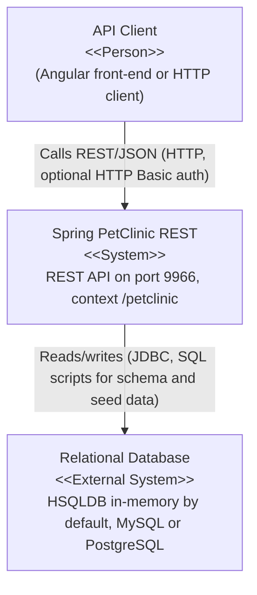
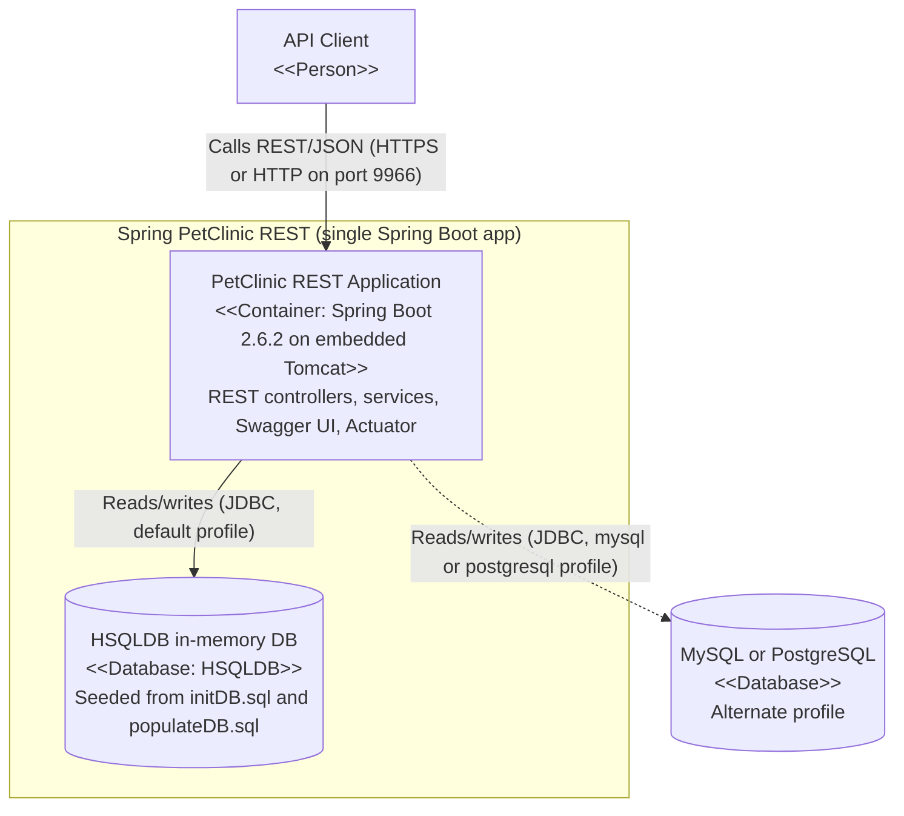
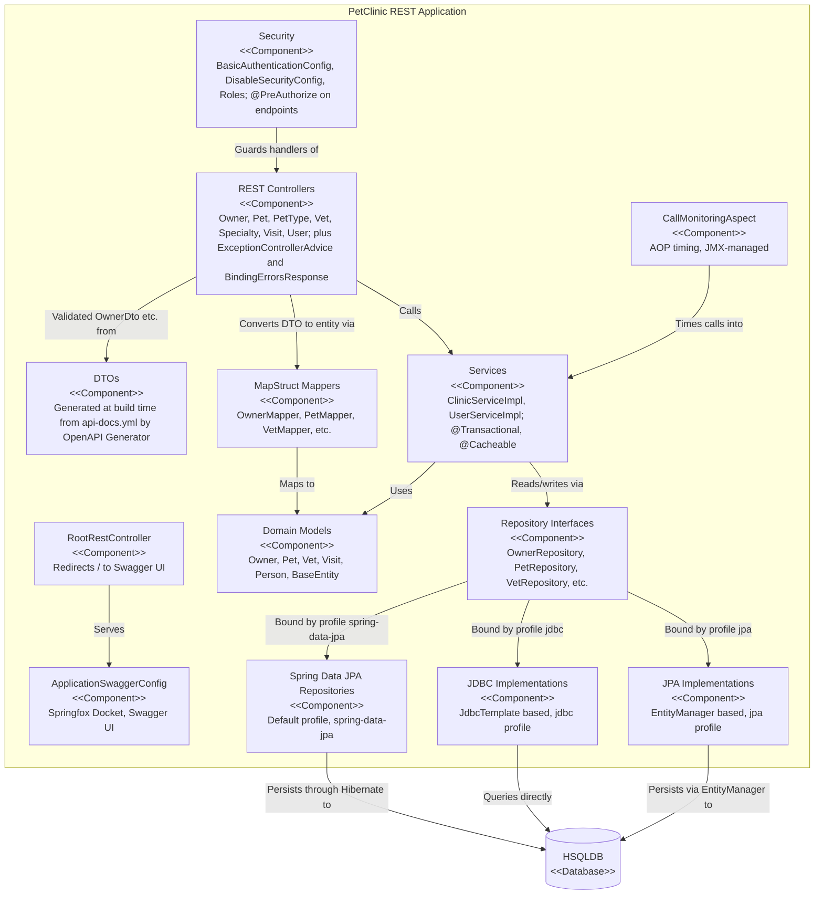

# Architecture: spring-petclinic-rest-legacy

## Project Overview
This repository is a freeze-fork of `spring-petclinic/spring-petclinic-rest` at v2.6.2, preserved as a "javax-era legacy specimen" (its description notes it exists for a modernization exercise, "Stage 080 Track B"). It is the pure REST backend of the Spring PetClinic sample application: a veterinary-clinic domain (owners, pets, pet types, vets, specialties, visits, users) exposed exclusively as a JSON REST API — the README states explicitly that "there is no UI", with a separate Angular front-end consuming the API. It is written in Java and built on Spring Boot 2.6.2, using `javax.*` (pre-Jakarta) APIs throughout.

## Technology Stack
- **Language:** Java (javax-era; `javax.transaction`, `javax.validation`, `javax.servlet`, `javax.sql`)
- **Framework:** Spring Boot 2.6.2 (`spring-boot-starter-web`, `data-jpa`, `jdbc`, `security`, `actuator`, `aop`, `cache`, `validation`)
- **API documentation:** Springfox 3.0.0 (Swagger 2 UI) with the Spring Boot 2.6 `ant_path_matcher` workaround; hand-maintained OpenAPI spec at `src/main/resources/api-docs.yml`
- **Code generation:** `openapi-generator-maven-plugin` 5.2.1 generates the `dto` package (`*Dto` classes, Bean Validation) from `api-docs.yml` at build time; **MapStruct** 1.4.1.Final maps DTO ↔ domain entities at compile time
- **Persistence:** three interchangeable repository backends — plain Spring JDBC, Spring Data JPA (Hibernate), and manual JPA `EntityManager` implementations — selected via Spring profiles; drivers for **HSQLDB** (default, in-memory), **MySQL**, and **PostgreSQL**
- **Quality/build:** Maven (via wrapper), JaCoCo coverage enforcement (≥87% line, ≥70% branch), `spring-boot-maven-plugin` build-info
- **Packaging:** Jib Maven plugin for Docker images; `SpringBootServletInitializer` also makes it WAR-deployable

## Component Architecture
Grouped by package under `src/main/java/org/springframework/samples/petclinic`:

- **`PetClinicApplication`** — Spring Boot entry point (`@SpringBootApplication`), extends `SpringBootServletInitializer` so the app can run as a fat jar or be deployed as a WAR. Depends on everything else via component scan.
- **`rest` (REST layer)** — `@RestController` classes exposing the API under the `/petclinic` context path: `OwnerRestController` (`/api/owners`), `PetRestController` (`/api/pets`), `PetTypeRestController`, `SpecialtyRestController`, `VetRestController`, `VisitRestController`, `UserRestController`, plus `RootRestController` (redirects `/` to Swagger UI), `ExceptionControllerAdvice` (global exception → JSON `ErrorInfo`), and `BindingErrorsResponse` (validation-error payload in an `errors` response header). Controllers depend on the service layer, MapStruct mappers, generated DTOs, and `@PreAuthorize` method security.
- **`service`** — `ClinicService`/`ClinicServiceImpl` (CRUD for owners, pets, visits; `@Transactional` methods, `@Cacheable` on some lookups, converts repository exceptions to 404-style `ObjectRetrievalFailureException`) and `UserService`/`UserServiceImpl` (login-name lookup for user management). Depend only on the repository interfaces.
- **`model`** — domain entities: `Owner`, `Pet`, `PetType`, `Specialty`, `Vet`, `Visit`, `User`, `Role`, built on `BaseEntity` (id/timestamp) and `NamedEntity`/`Person` (name, validation annotations). JPA-annotated POJOs shared by all three repository backends.
- **`dto`** — *generated at build time* (not in the tree) by OpenAPI Generator from `api-docs.yml`, into `target/generated-sources` and added to the build by `build-helper-maven-plugin`. These are the JSON wire models.
- **`mapper`** — MapStruct interfaces (`OwnerMapper`, `PetMapper`, etc.) translating between generated DTOs and `model` entities; registered as Spring beans via `defaultComponentModel=spring`.
- **`repository`** — the pluggable persistence seam. Top-level interfaces (`OwnerRepository`, `PetRepository`, `PetTypeRepository`, `SpecialtyRepository`, `VetRepository`, `VisitRepository`, `UserRepository`) with three profile-activated implementations: `jdbc/` (`JdbcTemplate`-based), `jpa/` (raw `EntityManager`), and `springdatajpa/` (Spring Data interfaces plus `*Override` classes). Default active profile is `spring-data-jpa`.
- **`security`** — `BasicAuthenticationConfig` (HTTP Basic + JDBC authentication against `users`/`roles` tables, CSRF disabled, `@EnableGlobalMethodSecurity` for `@PreAuthorize`), activated only when `petclinic.security.enable=true`; `DisableSecurityConfig` for the default; `Roles` bean holding role constants `ROLE_OWNER_ADMIN`, `ROLE_VET_ADMIN`, `ROLE_ADMIN` (injected into `@PreAuthorize` expressions as `@roles.OWNER_ADMIN`, etc.).
- **`util`** — `ApplicationSwaggerConfig` (Springfox `Docket` + `springfoxHandlerProviderBeanPostProcessor` to fix Boot 2.6 path-matching), `CallMonitoringAspect` (AOP aspect around `ClinicServiceImpl`/`UserServiceImpl` methods that records call count/duration and exposes JMX-managed operations), `EntityUtils`.

## Data Flow
Concrete example — **`POST /petclinic/api/owners` with a JSON body**: the request first passes the Spring Security filter chain (by default a permissive one from `DisableSecurityConfig`; if `petclinic.security.enable=true`, it must carry valid HTTP Basic credentials resolved against the `users`/`roles` tables, and `@PreAuthorize("hasRole(@roles.OWNER_ADMIN)")` on the handler is enforced). `OwnerRestController.addOwner` receives the body deserialized into the generated `OwnerDto`, validated with `@Valid`; on validation failure it returns 400 with a `BindingErrorsResponse` in the `errors` header. On success, `OwnerMapper.toOwner` (MapStruct) converts the DTO to the `Owner` domain entity, `ClinicService.saveOwner` persists it inside a `@Transactional` (with `CallMonitoringAspect` timing the call), and the active `OwnerRepository` implementation — `SpringDataOwnerRepository` under the default `spring-data-jpa` profile, backed by Hibernate — writes it to the in-memory HSQLDB. The controller then responds 201 CREATED with the DTO (id populated) and a `Location` header pointing at `/api/owners/{id}`. Read paths mirror this in reverse: repository → entity → MapStruct → `*Dto` → JSON, with Springfox serving the interactive API at `/petclinic/swagger-ui/index.html` and JaCoCo/Actuator (build-info) supporting observability.

## External Dependencies and Integrations
- **Relational database** — in-memory HSQLDB by default (`jdbc:hsqldb:mem:petclinic`, seeded by `db/hsqldb/initDB.sql` + `populateDB.sql`); MySQL and PostgreSQL supported via `application-mysql.properties` / `application-postgresql.properties` profiles and bundled drivers.
- **Springfox/Swagger UI** — serves API documentation from the running app; the static OpenAPI contract lives in `api-docs.yml` and doubles as the DTO code-generation source.
- **Client front-end** — the README references a separate Angular application consuming this REST API (not part of this repo).
- **JMX** — `CallMonitoringAspect` exposes managed attributes/operations to any JMX client.
- No message queues, caches beyond Spring's in-process `@Cacheable` abstraction, or other third-party services were found.

## Deployment Architecture
- **Build:** Maven (wrapper `mvnw` included); the build generates DTOs from `api-docs.yml` (OpenAPI Generator), compiles MapStruct mappers, enforces JaCoCo coverage gates, and records build info for Actuator.
- **CI:** a single GitHub Actions workflow, `.github/workflows/maven-build.yml` ("Java CI with Maven"), runs the standard Maven build on pushes/PRs. No deploy job was found in the repo.
- **Packaging:** runnable Spring Boot fat jar (embedded Tomcat); `PetClinicApplication extends SpringBootServletInitializer` also allows WAR deployment into a servlet container. The **Jib Maven plugin** builds and tags the container image `docker.io/springcommunity/spring-petclinic-rest:{2.6.2,latest}`.
- **Runtime configuration:** listens on port **9966** with context path `/petclinic/`; database and repository backend chosen via two orthogonal profile dimensions (DB: `hsqldb`/`mysql`/`postgresql`; persistence: `jdbc`/`jpa`/`spring-data-jpa`) — defaults to `hsqldb,spring-data-jpa`. No k8s manifests or Dockerfiles exist in the repo itself.

## Security Considerations
Observed, not assumed:
- **Auth is opt-in and disabled by default** — `petclinic.security.enable=false` in `application.properties`; `DisableSecurityConfig` is active unless the property is flipped to `true`, in which case `BasicAuthenticationConfig` engages.
- **HTTP Basic + JDBC authentication** — credentials checked against the `users` and `roles` tables via `usersByUsernameQuery`/`authoritiesByUsernameQuery` (data seeded in the DB scripts). Password `PasswordEncoder` bean is declared (`PasswordEncoderFactories.createDelegatingPasswordEncoder()`) but not wired into the JDBC auth chain in the code shown.
- **Method-level authorization** — `@EnableGlobalMethodSecurity(prePostEnabled = true)` with `@PreAuthorize("hasRole(@roles.OWNER_ADMIN)")` etc. on every CRUD endpoint; role constants live in the `Roles` `@Component` (`ROLE_OWNER_ADMIN`, `ROLE_VET_ADMIN`, `ROLE_ADMIN`).
- **CSRF is explicitly disabled** (`.csrf().disable()`), consistent with a stateless API, though the app otherwise ships no token/session mechanism.
- **Validation at the boundary** — `@Valid` on all request DTOs (Bean Validation annotations generated from the OpenAPI spec) with structured `BindingErrorsResponse` 400s.
- Caveat: in the default (disabled) configuration the entire API is unauthenticated — fine for a sample, worth flagging for any real deployment.

## C4 Diagrams

### System Context Diagram
The only actors with direct evidence are the API client (the README's Angular front-end, or any HTTP client) and the relational database it is configured to use; the Swagger UI is part of the system itself, not a separate external system. No CI/deploy or observability platforms are integrated in code, so they are omitted.

### Container Diagram
This is a single deployable unit: one Spring Boot jar/image containing the web server, services, and (by default) an in-memory database. No separate service, queue, or external database runs as its own container in the default configuration.

### Component Diagram
Zooming into the single application container: the internal layering is REST controllers → services → pluggable repository backends, with cross-cutting security, mapping, and DTO-generation concerns.

