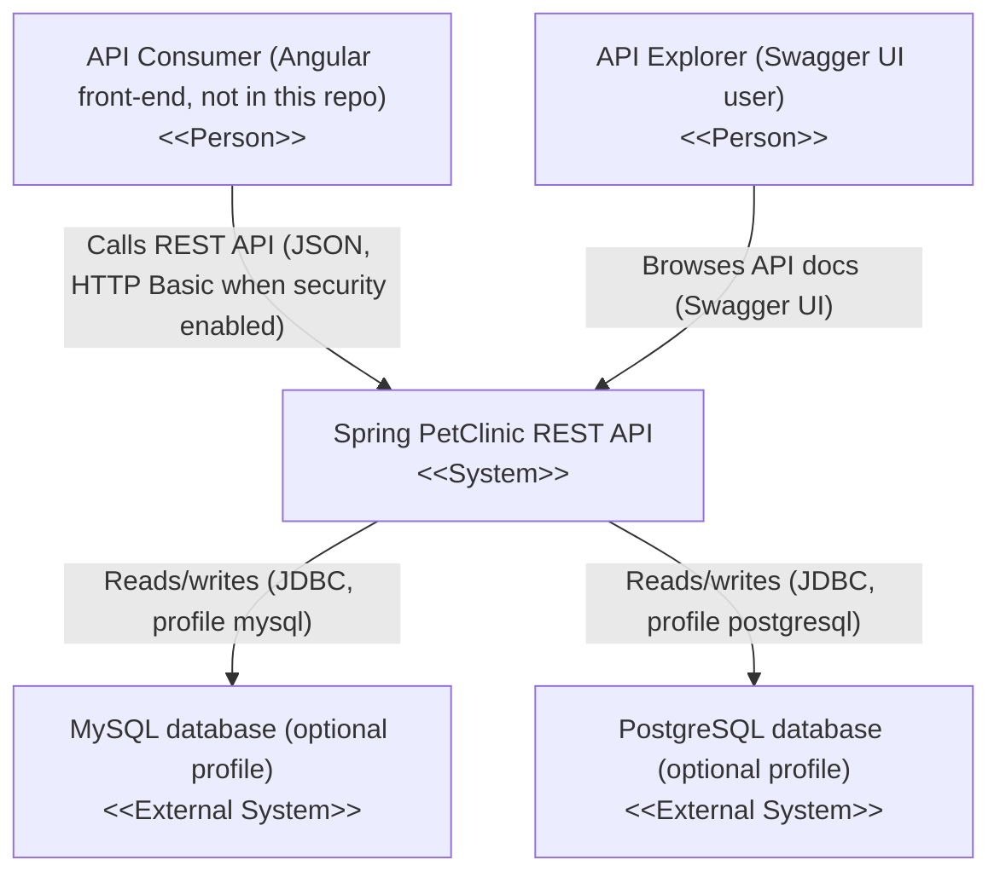
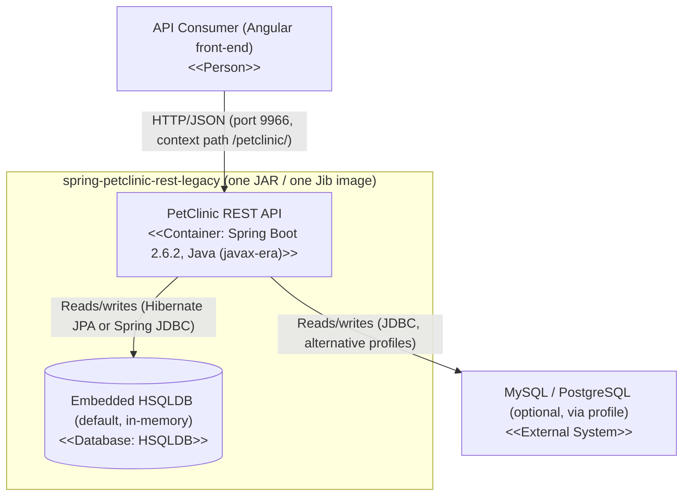

# Architecture: spring-petclinic-rest-legacy

## Project Overview

This repository is a freeze-fork of `spring-petclinic/spring-petclinic-rest` at v2.6.2, kept as a "javax-era legacy specimen" (per the repo description, for a "Stage 080 Track B" migration effort). It is the REST-only backend of the Spring PetClinic sample: a single Spring Boot 2.6.2 Java application that exposes the pet-clinic domain — owners, pets, pet types, vets, specialties, visits, and users — exclusively as a JSON REST API, with no UI. The README states: "This backend version of the Spring Petclinic application only provides a REST API. There is no UI. There is a Angular front-end application which consumes the REST API." The app's defining architectural trait is a pluggable persistence layer: the same repository interfaces can be backed by hand-written JDBC, hand-written JPA, or Spring Data JPA, selected at runtime via Spring profiles, over HSQLDB (default, in-memory), MySQL, or PostgreSQL.

## Technology Stack

- **Language**: Java (javax-era — `javax.persistence`, `javax.transaction`, `javax.validation`; built with JDK 11 in CI)
- **Framework**: Spring Boot 2.6.2 (parent), Spring MVC REST controllers, Spring Data JPA, Spring JDBC, Spring Security (JDBC-backed HTTP Basic), Spring AOP, Spring Cache, Spring Actuator
- **API tooling**: Springfox 3.0.0 (`@EnableSwagger2`, served API docs) with a manual `BeanPostProcessor` workaround for Spring Boot 2.6's `ant_path_matcher`
- **DTO generation**: `openapi-generator-maven-plugin` 5.2.1 generates all `*Dto` classes from `src/main/resources/api-docs.yml` at build time (models only, into `org.springframework.samples.petclinic.dto`)
- **Mapping**: MapStruct 1.4.1 (entity ↔ DTO mappers, Spring component model)
- **Persistence**: Hibernate/JPA and JdbcTemplate; HSQLDB (embedded, default), MySQL, PostgreSQL (all as runtime drivers); per-database `initDB.sql` / `populateDB.sql` scripts
- **Build/deploy**: Maven (with `.mvn` wrapper), JaCoCo coverage gates, Jib Maven plugin (no Dockerfile in repo), GitHub Actions CI
- **Observability**: Logback, JMX-exposed `CallMonitoringAspect`, Actuator, build-info plugin

## Component Architecture

- **`PetClinicApplication`** — Spring Boot entry point; extends `SpringBootServletInitializer`, so the app can also deploy as a WAR.
- **REST layer (`rest/`)** — Eight controllers: `OwnerRestController`, `PetRestController`, `PetTypeRestController`, `SpecialtyRestController`, `UserRestController`, `VetRestController`, `VisitRestController`, and `RootRestController` (service discovery/root info). Mapped under `/api/...` (context path `/petclinic/`). They accept/return generated `*Dto` types, apply `@Valid` + a custom `BindingErrorsResponse` (returned in a non-standard `errors` HTTP header with 400), set `Location` headers on creation, and gate endpoints with `@PreAuthorize("hasRole(@roles.OWNER_ADMIN)")`-style method security. `ExceptionControllerAdvice` maps unhandled exceptions to JSON error bodies via a `@ControllerAdvice`.
- **DTOs (`dto/`, generated)** — Not in source; generated at build time by the OpenAPI generator from `api-docs.yml` with Bean Validation and Jackson serialization.
- **Entity model (`model/`)** — JPA entities: `Owner`, `Pet`, `PetType`, `Vet`, `Visit`, `Specialty`, `User`, `Role`, with base classes `Person`/`NamedEntity`/`BaseEntity`. Plain `javax.persistence` domain model (e.g. `Owner` holds a sorted `List<Pet>` and manages pet add/get logic in the entity itself).
- **Mapping layer (`mapper/`)** — MapStruct interfaces (`OwnerMapper`, `PetMapper`, etc.) converting between entities and generated DTOs.
- **Service layer (`service/`)** — `ClinicService`/`ClinicServiceImpl` (all owner/pet/visit/vet/specialty business logic; `@Transactional` writes, `@Cacheable` reads, maps `ObjectRetrievalFailureException`/`DataAccessException` to null/empty results) and `UserService`/`UserServiceImpl`.
- **Repository abstraction (`repository/`)** — Plain interfaces (`OwnerRepository`, `PetRepository`, `VisitRepository`, …) with **three** profile-activated implementations:
  - `jdbc/` — hand-written `JdbcTemplate` implementations (e.g. `JdbcOwnerRepositoryImpl`, `JdbcVetRepositoryImpl`, plus row mappers and a `JdbcPetVisitExtractor`), profile `jdbc`
  - `jpa/` — hand-written `EntityManager` implementations, profile `jpa`
  - `springdatajpa/` — Spring Data JPA repository interfaces (e.g. `SpringDataPetRepository`) with small `*Override` adapter interfaces, profile `spring-data-jpa` (the default)
- **Security (`security/`)** — `BasicAuthenticationConfig` (HTTP Basic, CSRF disabled, JDBC authentication against `users`/`roles` tables, `@EnableGlobalMethodSecurity` for `@PreAuthorize`) is `@ConditionalOnProperty(petclinic.security.enable=true)`; `DisableSecurityConfig` applies by default (property is `false` in `application.properties`). `Roles` is a component exposing role constants used by `@PreAuthorize` expressions.
- **Utilities (`util/`)** — `ApplicationSwaggerConfig` (Springfox `Docket` + reflection-based `BeanPostProcessor` fixing the Spring Boot 2.6 handler-mapping incompatibility), `CallMonitoringAspect` (AOP around `service.*` calls, JMX-exposed call count/time), `EntityUtils`.
- **Resources** — `application.properties` (port **9966**, context path `/petclinic/`, active profiles `hsqldb,spring-data-jpa`, springfox `ant_path_matcher` workaround, security off by default); `application-{hsqldb,mysql,postgresql}.properties` (datasource URLs + `db/{db}/initDB.sql` and `populateDB.sql` locations); `api-docs.yml` (OpenAPI 2 spec that is the source of truth for DTOs); i18n `messages/*.properties`; `logback.xml`.

## Data Flow

Concrete example — `POST /petclinic/api/owners`: the request reaches `OwnerRestController.addOwner`, where the incoming `OwnerDto` (a class generated from `api-docs.yml`, validated with Bean Validation) is checked via `BindingResult`; on validation failure or a non-null `id` the controller returns 400 with a JSON `errors` HTTP header. On success, `OwnerMapper` (MapStruct) converts the DTO to an `Owner` entity, `ClinicServiceImpl.saveOwner` persists it inside a transaction, which flows through the active-profile repository — `SpringDataOwnerRepository` by default (profile `spring-data-jpa`) — down through Hibernate into the in-memory HSQLDB (`jdbc:hsqldb:mem:petclinic`, seeded at startup by `initDB.sql` + `populateDB.sql`). The controller then responds `201 Created` with a `Location: /api/owners/{id}` header built via `UriComponentsBuilder`. Read paths (e.g. `GET /api/owners/{id}`) go controller → `ClinicServiceImpl` (some cached with `@Cacheable`) → repository → DB, and `@Cacheable`/transactional behavior is cut through by the `CallMonitoringAspect` AOP advice for JMX metrics. Swagger UI/API docs are generated by Springfox from the live controller mappings, while the build-time OpenAPI generator runs the opposite direction: `api-docs.yml` → DTO sources.

## External Dependencies and Integrations

- **Databases**: embedded HSQLDB in-memory (default); optional MySQL (`mysql-connector-java`) and PostgreSQL (`postgresql`) via profiles — no database is required at build time
- **OpenAPI generator**: build-time code generation from `src/main/resources/api-docs.yml`
- **API consumers**: per the README, a separate Angular front-end application consumes this REST API (not in this repo)
- **No** message queues, external REST calls, or third-party SaaS integrations were found in the code
- Maven Central for all build dependencies (Spring Boot parent manages versions)

## Deployment Architecture

- **Artifact**: a Spring Boot fat JAR (also WAR-deployable thanks to `SpringBootServletInitializer`), built by Maven; the `spring-boot-maven-plugin` produces `build-info` for Actuator, and JaCoCo enforces coverage gates (87% line / 70% branch) at build time
- **Container image**: **no Dockerfile in the repo** — the image is built by the Jib Maven plugin (`com.google.cloud.tools:jib-maven-plugin:1.3.0`) targeting `docker.io/springcommunity/spring-petclinic-rest` with tags `2.6.2` and `latest`
- **CI/CD**: GitHub Actions workflow (`.github/workflows/maven-build.yml`) runs `mvn -B install` on `ubuntu-latest` with AdoptOpenJDK 11 and Maven caching; it triggers on push/PR to `master`, which is a latent mismatch since this fork's default branch is `main` (a side effect of forking upstream) — worth noting for anyone re-enabling CI here
- **Runtime configuration**: entirely via Spring profiles — `spring.profiles.active` picks one DB profile (`hsqldb`/`mysql`/`postgresql`) and one repository profile (`jdbc`/`jpa`/`spring-data-jpa`), e.g. `hsqldb,jdbc` to run JDBC over HSQLDB
- **No** Kubernetes manifests, Helm charts, or service discovery configs were found

## Security Considerations

- **Authentication is disabled by default**: `petclinic.security.enable=false` in `application.properties` activates `DisableSecurityConfig`; `BasicAuthenticationConfig` only engages when the property is `true`
- **When enabled**: HTTP Basic authentication via `jdbcAuthentication()` against the `users` (`username,password,enabled`) and `roles` (`username,role`) tables seeded by the SQL scripts; `CSRF` is explicitly disabled; a `PasswordEncoder` bean is declared
- **Method-level authorization**: `@EnableGlobalMethodSecurity(prePostEnabled=true)` with `@PreAuthorize("hasRole(@roles.OWNER_ADMIN)")` etc. on controller methods; role names come from the `Roles` Spring component (`security/Roles.java`)
- **Input validation**: Bean Validation on generated DTOs, with errors surfaced via the custom `errors` response header (a non-standard, security-relevant choice — errors bypass the JSON body)
- **CORS**: `@CrossOrigin(exposedHeaders = "errors, content-type")` on `OwnerRestController`
- No secrets management, no TLS termination config, and no RBAC beyond the single-role model above were observed — consistent with a sample application

## C4 Diagrams

### System Context Diagram

The system is a single REST API. Per the README, an external Angular front-end consumes it; the optional MySQL/PostgreSQL databases are external only when those profiles are chosen (HSQLDB is embedded in-process, so it does not appear at this level).



### Container Diagram

The repo is a single deployable Spring Boot application with an embedded (default) database, so the Container diagram is intentionally simple. The image is produced by Jib at build time; there is no separate DB container, queue, or worker in this repo.



### Component Diagram

Zoom into the Spring Boot container. The most notable internal structure is the three-way pluggable repository layer selected by Spring profile.

```mermaid
flowchart TB
    subgraph App["PetClinicApplication (Spring Boot)"]
        SwaggerCfg["Swagger config (Springfox, api-docs.yml)
&lt;&lt;Component&gt;&gt;"]
        DtoGen["Generated DTOs (OpenAPI generator, build-time)
&lt;&lt;Component&gt;&gt;"]
        RestControllers["REST controllers (/api/owners, /api/pets, /api/vets, ...)
&lt;&lt;Component&gt;&gt;"]
        Advice["ExceptionControllerAdvice + BindingErrorsResponse
&lt;&lt;Component&gt;&gt;"]
        Mappers["MapStruct entity-to-DTO mappers
&lt;&lt;Component&gt;&gt;"]
        Services["ClinicService / UserService (transactional, cached)
&lt;&lt;Component&gt;&gt;"]
        Aspect["CallMonitoringAspect (AOP, JMX metrics)
&lt;&lt;Component&gt;&gt;"]
        SecurityCfg["Security configs (Basic auth, role-based @PreAuthorize)
&lt;&lt;Component&gt;&gt;"]
        RepoApi["Repository interfaces (Owner, Pet, Vet, Visit, ...)
&lt;&lt;Component&gt;&gt;"]
        JdbcImpls["JDBC implementations (profile jdbc)
&lt;&lt;Component&gt;&gt;"]
        JpaImpls["Hand-written JPA implementations (profile jpa)
&lt;&lt;Component&gt;&gt;"]
        SdJpaImpls["Spring Data JPA repositories (profile spring-data-jpa, default)
&lt;&lt;Component&gt;&gt;"]
        Entities["JPA entities (Owner, Pet, Vet, Visit, ...)
&lt;&lt;Component&gt;&gt;"]
    end
    Hsqldb[("HSQLDB (default) / MySQL / PostgreSQL
&lt;&lt;Database&gt;&gt;"]
    DtoGen -->|"DTO types"| RestControllers
    RestControllers -->|"Validates DTOs, calls"| Services
    RestControllers -->|"Converts entity to DTO"| Mappers
    Advice -.->|"Handles exceptions"| RestControllers
    SecurityCfg -.->|"AuthN/authZ guard"| RestControllers
    SwaggerCfg -.->|"Exposes API docs"| RestControllers
    Aspect -.->|"Observes calls to"| Services
    Services -->|"Uses"| Entities
    Services -->|"Calls"| RepoApi
    RepoApi -->|"Profile jdbc"| JdbcImpls
    RepoApi -->|"Profile jpa"| JpaImpls
    RepoApi -->|"Profile spring-data-jpa (default)"| SdJpaImpls
    JdbcImpls -->|"JdbcTemplate SQL"| Hsqldb
    JpaImpls -->|"EntityManager"| Hsqldb
    SdJpaImpls -->|"Hibernate queries"| Hsqldb
```