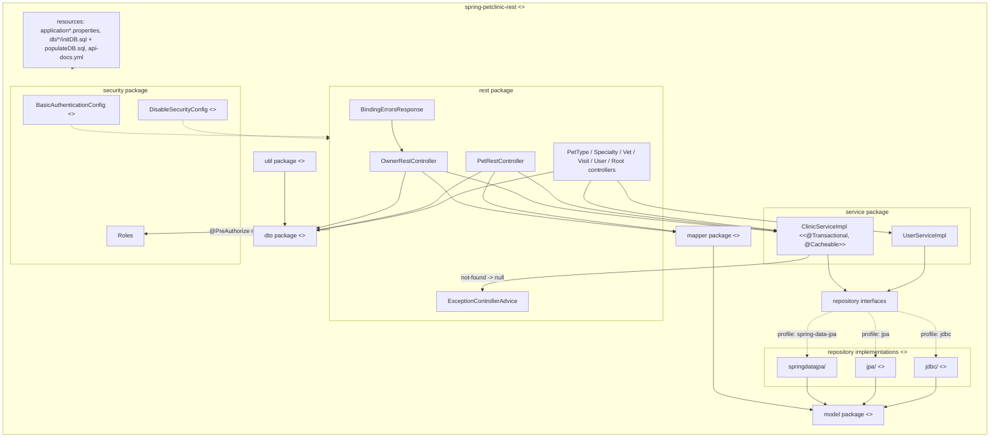
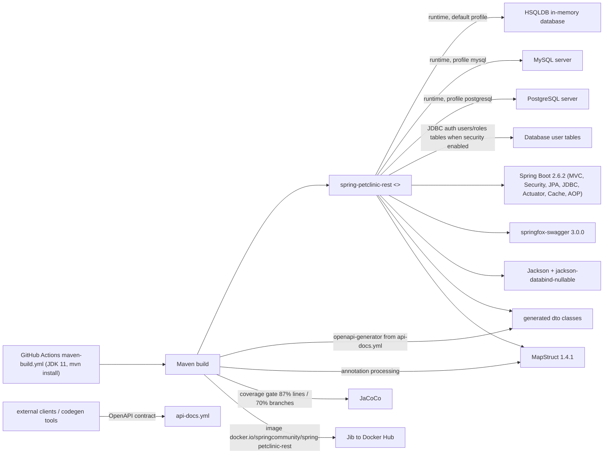

# Architecture: spring-petclinic-rest-legacy

## Project Overview
This repository is a **freeze-fork of `spring-petclinic/spring-petclinic-rest` at v2.6.2**, explicitly kept as a "javax-era legacy specimen for Stage 080 Track B" (per the repo description) — i.e., a deliberately un-migrated baseline for a Spring modernization exercise. The application itself is the Spring Petclinic REST sample: a pet-clinic domain (owners, pets, pet types, vets, specialties, visits, users) exposed as a JSON REST API on port 9966 under the `/petclinic/` context path. It is a single Spring Boot 2.6.2 (javax-era) web application in Java 11, notable for shipping **three swappable repository backends** (Spring Data JPA, raw JPA, and Spring JDBC) selected at runtime via Spring profiles.

## Technology Stack
- **Language/runtime**: Java 11 (CI: `actions/setup-java` with JDK 11, AdoptOpenJDK)
- **Framework**: Spring Boot 2.6.2 (`spring-boot-starter-parent`), Spring MVC (`starter-web`), Spring Boot Actuator, AOP, Cache starters
- **Security**: Spring Security 5.x — HTTP Basic + JDBC user details, `@EnableGlobalMethodSecurity(prePostEnabled=true)`, `javax`-era `WebSecurityConfigurerAdapter`
- **Persistence**: Spring Data JPA / Hibernate (`starter-data-jpa`), Spring JDBC (`starter-jdbc`), `javax.persistence`/`javax.validation` (pre-Jakarta)
- **Databases**: HSQLDB (default, in-memory), MySQL, PostgreSQL — all runtime drivers present; schema/seed SQL per DB under `src/main/resources/db/`
- **API tooling**: OpenAPI spec (`src/main/resources/api-docs.yml`), springfox-swagger 3.0.0, **openapi-generator-maven-plugin 5.2.1** generating `*Dto` classes into `org.springframework.samples.petclinic.dto`, MapStruct 1.4.1 (annotation-processor mapping, `componentModel=spring`)
- **Build/QA**: Maven (with `.mvn/wrapper`), JaCoCo (87% line / 70% branch coverage gate, generated DTOs excluded)
- **Packaging**: Google Jib Maven plugin (`docker.io/springcommunity/spring-petclinic-rest:<version>|latest`) — no Dockerfile in repo

## Component Architecture
All code lives under `src/main/java/org/springframework/samples/petclinic/`:

- **`PetClinicApplication`** — `@SpringBootApplication` entry point; extends `SpringBootServletInitializer` (war-deployable). Depends on: everything (component scan root).
- **`rest/`** — REST API layer: `OwnerRestController`, `PetRestController`, `PetTypeRestController`, `SpecialtyRestController`, `VetRestController`, `VisitRestController`, `UserRestController`, `RootRestController` (API root), plus `ExceptionControllerAdvice` (global 404/500 handling) and `BindingErrorsResponse` (JSON error payload carried in an `errors` response header on 400). All controllers are `@RequestMapping("/api/...")`, `@CrossOrigin(exposedHeaders = "errors, content-type")`, and guard methods with `@PreAuthorize("hasRole(@roles.…)")` (e.g., `@roles.OWNER_ADMIN`). Depends on: `service/` and `mapper/`, generated `dto/` classes.
- **`dto/`** (generated) — `*Dto` request/response models generated at build time by openapi-generator from `api-docs.yml` (generator `spring`, library `spring-boot`, suffix `Dto`, Bean Validation enabled). Never hand-edited; excluded from JaCoCo.
- **`mapper/`** — MapStruct interfaces (`OwnerMapper`, `PetMapper`, `PetTypeMapper`, `SpecialtyMapper`, `UserMapper`, `VetMapper`, `VisitMapper`) converting between DTOs and domain entities. Depends on: `model/`, `dto/`.
- **`model/`** — JPA entities: `Owner` (extends `Person`, `@Table(name="owners")`, eager `OneToMany` pets), `Pet`, `PetType`, `Vet`, `Specialty`, `Visit`, `User`, `Role`, plus base classes `BaseEntity`/`NamedEntity`. Use `javax.persistence` + `javax.validation` constraints.
- **`service/`** — `ClinicService`/`ClinicServiceImpl`: the facade through which all controllers do data access; constructor-injects the six domain repositories, applies `@Transactional` (readOnly where appropriate), `@Cacheable(value="vets")`, and swallows not-found exceptions to return `null`. Also `UserService`/`UserServiceImpl` for user lookups.
- **`repository/`** — Domain repository **interfaces** (`OwnerRepository`, `PetRepository`, `PetTypeRepository`, `VetRepository`, `SpecialtyRepository`, `VisitRepository`, `UserRepository`) with **three parallel implementations** selected by Spring profile:
  - `repository/springdatajpa/` — Spring Data JPA repositories (e.g., `SpringDataOwnerRepository`) plus hand-written query overrides (`PetRepositoryOverride`, `VisitRepositoryOverride`, etc.)
  - `repository/jpa/` — plain JPA `EntityManager` implementations (`Jpa*RepositoryImpl`)
  - `repository/jdbc/` — Spring `JdbcTemplate` implementations (`Jdbc*RepositoryImpl`, row mappers, `JdbcPet`/`JdbcVisit` DTOs)
  Default profile combination is `hsqldb,spring-data-jpa` per `application.properties`.
- **`security/`** — Two mutually exclusive `WebSecurityConfigurerAdapter` configs gated by `@ConditionalOnProperty("petclinic.security.enable")`: `BasicAuthenticationConfig` (HTTP Basic, `anyRequest().authenticated()`, CSRF disabled, JDBC auth against `users`/`roles` tables, method security enabled) and `DisableSecurityConfig` (permit-all, the **default** since the property defaults to `false`). `Roles` provides role-name constants referenced by the `@PreAuthorize` expressions.
- **`util/`** — `ApplicationSwaggerConfig` (springfox `Docket` for Swagger UI), `CallMonitoringAspect` (AOP call logging), `EntityUtils` (isNew checks).
- **`src/main/resources/`** — `application.properties` + per-database profiles (`application-hsqldb.properties`, `-mysql`, `-postgresql`); `db/<engine>/initDB.sql` + `populateDB.sql` schema/seed scripts; `api-docs.yml` (source of truth for DTOs); i18n `messages/messages*.properties`; `logback.xml`.

## Data Flow
Trace of `POST /petclinic/api/owners` (default config, security disabled, `hsqldb,spring-data-jpa` profile):

1. The HTTP request hits the embedded Tomcat on port **9966**, context path `/petclinic/`.
2. The Spring Security filter chain runs, but `DisableSecurityConfig` is active (`petclinic.security.enable=false`), so the request is permitted. (If the property were `true`, HTTP Basic credentials would be verified against the `users`/`roles` tables first.)
3. `OwnerRestController.addOwner` receives the JSON body, Jackson deserializes it into the generated `OwnerDto` (Bean Validation via `javax.validation`), and any `BindingResult` errors — or a non-null id — produce a **400 with a `BindingErrorsResponse` JSON payload in an `errors` header**.
4. `OwnerMapper` (MapStruct) converts `OwnerDto` → domain `Owner`; `ClinicServiceImpl.saveOwner` (a `@Transactional` facade method) calls `OwnerRepository.save(...)`.
5. The bean resolved by the active profile — `SpringDataOwnerRepository` under `spring-data-jpa` — persists via Hibernate/JPA to the in-memory HSQLDB database, which was bootstrapped from `db/hsqldb/initDB.sql` + `populateDB.sql` at startup.
6. The saved entity's id is copied back into the DTO; the controller returns **201** with a `Location: /api/owners/{id}` header.
7. Reads (e.g., `GET /api/owners`) flow the same way in reverse: repository → entity → MapStruct → `OwnerDto` → Jackson JSON. `findVets()` is cached in the Spring Cache abstraction. Unknown paths/ids are converted by `ExceptionControllerAdvice` into 404/500 responses. Swagger/OpenAPI metadata is served by springfox from `api-docs.yml` for client/tooling consumption.

## External Dependencies and Integrations
- **Databases**: HSQLDB (in-memory, default), MySQL, PostgreSQL — selected by profile; each has its own `initDB.sql`/`populateDB.sql` scripts and `application-*.properties` (connection URLs for external MySQL/Postgres instances). No message queues or third-party SaaS APIs are used.
- **Springfox/Swagger** — publishes the OpenAPI description (`api-docs.yml` + Swagger UI) for external clients and codegen tools.
- **Maven Central / OpenAPI tooling at build time**: openapi-generator (5.2.1), MapStruct processor, JaCoCo.
- **OpenAPI spec (`api-docs.yml`)** — effectively an external contract: DTO classes are generated from it, so the spec is the integration point for consumers generating clients.

## Deployment Architecture
- **Packaging**: Jib Maven plugin builds the container image directly (no Dockerfile in the repo), tagged `docker.io/springcommunity/spring-petclinic-rest:2.6.2` and `:latest`. The `spring-boot-maven-plugin` also produces the standard executable jar and `build-info` for Actuator.
- **CI/CD**: A single GitHub Actions workflow (`.github/workflows/maven-build.yml`) runs `mvn -B install` on JDK 11 (which also executes tests and the JaCoCo coverage gate). Note: the workflow triggers on `push`/`pull_request` to **`master`**, while this fork's default branch is **`main`** — so as frozen, CI would not fire on this repo's default branch (a quirk of the fork, inherited from upstream).
- **Runtime configuration** is purely Spring-profile based: `spring.profiles.active=hsqldb,spring-data-jpa` by default, switchable to `mysql`/`postgresql` and `jpa`/`jdbc` without code changes.
- **No k8s manifests, Helm charts, or IaC** were found in the repository.

## Security Considerations
- **Security is off by default**: `petclinic.security.enable=false` in `application.properties`, which activates `DisableSecurityConfig` (`anyRequest().permitAll()`, CSRF disabled). Anyone can run the app fully open.
- **When enabled** (`petclinic.security.enable=true`), `BasicAuthenticationConfig` applies: HTTP Basic authentication, `anyRequest().authenticated()`, CSRF disabled, and JDBC-backed user details (`select username,password,enabled from users where username=?` / `select username,role from roles where username=?`). No `PasswordEncoder` is explicitly configured — password encoding relies on Spring Security's default behavior for JDBC auth.
- **Method-level RBAC**: `@EnableGlobalMethodSecurity(prePostEnabled = true)` plus `@PreAuthorize("hasRole(@roles.OWNER_ADMIN)")`-style guards on every controller method, with role names centralized in `security/Roles`. This method security is in place even in the disabled mode, but has no effect while `permitAll` governs the filter chain.
- **Input validation**: `javax.validation` constraints on both generated DTOs and entities; `BindingErrorsResponse` returns structured field errors (400) rather than stack traces.
- **Legacy-risk notes**: `WebSecurityConfigurerAdapter` and `javax.*` namespaces were superseded (Boot 2.7+/3.x, Jakarta), and springfox 3.0.0 is incompatible with Spring 6 — both are the reason this fork exists as a migration baseline.

## Diagrams

### Component Diagram


### Data Flow Diagram
```mermaid
sequenceDiagram
    participant Client as REST Client
    participant Sec as "Spring Security filter chain (permitAll by default)"
    participant Ctrl as OwnerRestController
    participant Mapper as OwnerMapper (MapStruct)
    participant Svc as ClinicServiceImpl
    participant Repo as SpringDataOwnerRepository
    participant Db as "HSQLDB (in-memory, seeded by initDB.sql)"

    Client->>Sec: POST /petclinic/api/owners (JSON)
    Sec->>Ctrl: request (authenticated only if petclinic.security.enable=true)
    Ctrl->>Ctrl: deserialize to OwnerDto, javax.validation
    alt validation errors or id present
        Ctrl-->>Client: 400 + "errors" header (BindingErrorsResponse JSON)
    else valid
        Ctrl->>Mapper: OwnerDto to Owner
        Mapper->>Svc: saveOwner(owner)
        Svc->>Repo: save (inside transaction)
        Repo->>Db: INSERT or UPDATE owners
        Db-->>Repo: row id
        Repo-->>Svc: saved entity
        Svc-->>Mapper: entity
        Mapper-->>Ctrl: OwnerDto with id
        Ctrl-->>Client: 201 Created + Location /api/owners/id
    end
    Note over Client,Db: GET flows run in reverse; findVets() is cached; 404/500 handled by ExceptionControllerAdvice
```

### Dependency Diagram
