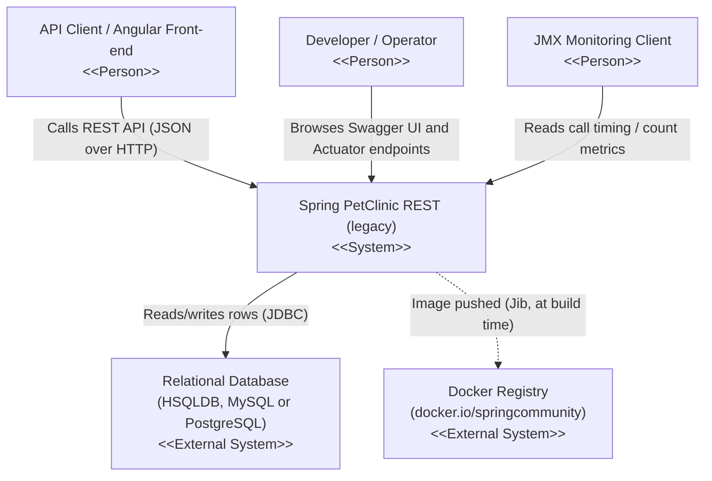
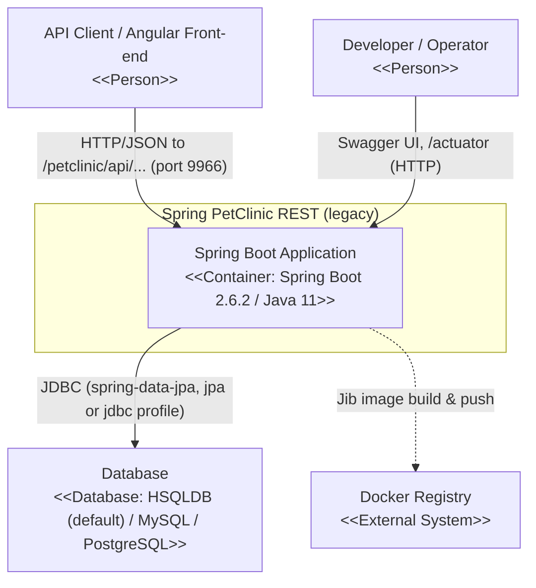

# Architecture: spring-petclinic-rest-legacy

## Project Overview
This is a **freeze-fork of `spring-petclinic/spring-petclinic-rest` at v2.6.2** — a "javax-era legacy specimen" (per the repo description) kept for migration/demo purposes (Stage 080 Track B, registered in a Backstage developer hub via `catalog-info.yaml`). The project itself is the REST-only backend of the well-known Spring PetClinic sample: as the readme puts it, it "only provides a REST API" with "no UI" — an Angular front-end (lived in a separate project) consumes it. It exposes CRUD endpoints for owners, pets, pet types, vets, specialties, visits, and users over JSON, with pluggable persistence (JPA, Spring Data JPA, or plain Spring JDBC) and pluggable databases (HSQLDB, MySQL, PostgreSQL), both selected by Spring profiles.

## Technology Stack
- **Language / runtime:** Java 11 (JDK 11 in CI), javax.* namespace (pre-Jakarta)
- **Framework:** Spring Boot 2.6.2 (parent POM), Spring Web MVC, Spring Security, Spring AOP, Spring Cache, Spring JDBC, Spring Data JPA
- **API documentation:** Springfox 3.0.0 (Swagger 2 UI), plus a checked-in OpenAPI spec `src/main/resources/api-docs.yml` used at build time
- **Code generation:** OpenAPI Generator Maven plugin 5.2.1 (generates `*Dto` classes from `api-docs.yml` into `org.springframework.samples.petclinic.dto`); MapStruct 1.4.1 (DTO ↔ domain model mappers, Spring component model)
- **Persistence:** HSQLDB (default, embedded), MySQL and PostgreSQL connectors (runtime scope); per-database `initDB.sql`/`populateDB.sql` scripts
- **Observability:** Spring Boot Actuator, JMX-enabled AOP call-monitoring aspect, Logback, JaCoCo coverage enforcement (87% line / 70% branch minimums)
- **Packaging/deployment:** Maven (wrapper included), Jib Maven plugin 1.3.0 (Docker image `docker.io/springcommunity/spring-petclinic-rest`), `SpringBootServletInitializer` (WAR-deployable)
- **CI:** GitHub Actions (Maven build); catalog annotation references Tekton CI externally

## Component Architecture
All source lives under `src/main/java/org/springframework/samples/petclinic/`:

- **`PetClinicApplication`** — Spring Boot entry point; extends `SpringBootServletInitializer` so the app can also run as a WAR in a servlet container. Serves on port **9966** under context path **`/petclinic/`**.
- **`rest/`** — HTTP layer. Seven REST controllers (`OwnerRestController`, `PetRestController`, `PetTypeRestController`, `VetRestController`, `SpecialtyRestController`, `VisitRestController`, `UserRestController`) mapped under `/api/...`, plus `RootRestController` (root landing/redirect), `ExceptionControllerAdvice` (global `@ControllerAdvice` turning exceptions into JSON error bodies), and `BindingErrorsResponse` (serialized validation-error payloads sent in an `errors` response header). Controllers depend on the service layer and the MapStruct mappers.
- **`service/`** — Business logic. `ClinicService`/`ClinicServiceImpl` handles owners, pets, pets' visits, pet types, vets and specialties with `@Transactional` and `@Cacheable` (e.g. cached pet-type/specialty lookups); `UserService`/`UserServiceImpl` handles application users. Depends only on the repository interfaces.
- **`repository/`** — Data access, the most distinctive part of this codebase: abstract repository *interfaces* (`OwnerRepository`, `PetRepository`, `PetTypeRepository`, `VetRepository`, `SpecialtyRepository`, `VisitRepository`, `UserRepository`) with **three parallel implementations** chosen by Spring profile — `repository/jdbc/` (hand-written Spring JDBC + row mappers), `repository/jpa/` (JPA entities via `@Repository` impls), and `repository/springdatajpa/` (Spring Data JPA repositories, including `*Override` beans that satisfy the abstract interfaces and query-derivation `Impl` classes).
- **`model/`** — Domain entities: `Owner`, `Pet`, `PetType`, `Vet`, `Visit`, `Specialty`, `User`, `Role`, built on `BaseEntity` (id + optimistic `modified` version field) → `NamedEntity`/`Person`.
- **`mapper/`** — MapStruct interfaces (`OwnerMapper`, `PetMapper`, etc.) converting between generated DTOs and domain models.
- **`security/`** — `BasicAuthenticationConfig` (HTTP Basic + JDBC user-store authentication from `users`/`roles` tables, method security via `@EnableGlobalMethodSecurity` so controllers can use `@PreAuthorize("hasRole(@roles.OWNER_ADMIN)")`), `DisableSecurityConfig` (permitAll; active **by default** since `petclinic.security.enable=false`), and the `Roles` `@Component` referenced by SpEL role expressions.
- **`util/`** — `ApplicationSwaggerConfig` (Springfox `Docket` with the Spring Boot 2.6 `ant_path_matcher` workaround and a `BeanPostProcessor` fixing the known Springfox/Breakpoint compatibility issue), `CallMonitoringAspect` (JMX-exported call counts/timing), `EntityUtils` (date handling for the `modified` version field).
- **Generated code** — `dto/*` classes are not in the repo; they are generated at build time from `api-docs.yml` by the OpenAPI generator (JaCoCo explicitly excludes `**/dto/**`).

## Data Flow
Concrete example — `POST /petclinic/api/owners` with a JSON body:

1. The request hits `OwnerRestController.addOwner`. If security is enabled, Spring Security authenticates the caller via HTTP Basic (credentials checked against the `users`/`roles` DB tables) and `@PreAuthorize("hasRole(@roles.OWNER_ADMIN)")` authorizes it.
2. Jackson binds the body to the generated `OwnerDto`; `@Valid` bean validation is applied. On validation failure (or a non-null id), no service call is made — the controller returns `400 Bad Request` with the errors serialized by `BindingErrorsResponse` into an `errors` response header.
3. Otherwise `OwnerMapper.toOwner` (MapStruct) converts the DTO to a domain `Owner`, and `ClinicServiceImpl.saveOwner` persists it through the `OwnerRepository` interface — the concrete implementation (Spring Data JPA by default, or JPA or JDBC, per the active repository profile) executes the insert against the active DataSource (HSQLDB by default; `initDB.sql`/`populateDB.sql` seeded it at startup).
4. The controller sets a `Location: /api/owners/{id}` header and returns `201 Created` with the populated DTO.

Read paths follow the same chain in reverse, with `@Cacheable` in `ClinicServiceImpl` (e.g. pet-type lookups) served from Spring's cache before touching the repository. `GET` responses include HATEOAS-style link headers built with `UriComponentsBuilder`. Exceptions thrown anywhere in the service/repository layer are caught by `ExceptionControllerAdvice` and rendered as JSON. The `CallMonitoringAspect` wraps service/repository calls for JMX-exposed timing and count metrics, and Actuator exposes health/info endpoints under `/petclinic/actuator/...`.

## External Dependencies and Integrations
- **Relational database** — HSQLDB embedded by default; MySQL or PostgreSQL via profile + external server (setup instructions in `db/mysql/petclinic_db_setup_mysql.txt`, `db/postgresql/petclinic_db_setup_postgresql.txt`). The `users`/`roles` tables double as the Spring Security user store.
- **Angular front-end** (separate application, per readme) — the intended API consumer.
- **JMX** — `CallMonitoringAspect` exposes `@ManagedResource`/`@ManagedAttribute` metrics to any JMX client.
- **Docker registry** — Jib is configured to push `docker.io/springcommunity/spring-petclinic-rest` (v2.6.2 and `latest` tags).
- **Backstage/Developer Hub** — `catalog-info.yaml` registers this repo as a `Component` (owner `demo-team`, `tekton.dev/cicd: "true"`) for external Tekton CI and agent demos; no pipeline definitions live in this repo.
- No message queues, no third-party HTTP APIs.

## Deployment Architecture
- **Build:** Maven (wrapper `mvnw` included); the OpenAPI generator runs during `generate-sources` and `build-helper` adds the generated DTO sources; JaCoCo enforces coverage gates; `spring-boot-maven-plugin` produces the Boot artifact plus `build-info` for Actuator.
- **Container image:** Jib Maven plugin builds `docker.io/springcommunity/spring-petclinic-rest:{version,latest}` (Jib 1.3.0 — itself a legacy tool, consistent with the "legacy specimen" purpose). There is **no Dockerfile** in the repo, and **no Kubernetes manifests**; deployment is expected to be handled externally (Backstage/Tekton annotations only).
- **WAR option:** `PetClinicApplication extends SpringBootServletInitializer`, so the app is deployable to a servlet container as a WAR.
- **Configuration:** `application.properties` sets the default profiles (`hsqldb,spring-data-jpa`), port 9966, context path `/petclinic/`, security disabled. Profile-specific files (`application-{hsqldb,mysql,postgresql}.properties`) supply DataSource settings.
- **CI:** GitHub Actions workflow `maven-build.yml` (JDK 11 adopt, `mvn -B install`) — note it triggers on push/PR to branch `master` while the repo's default branch is `main`, i.e. the inherited upstream CI is not currently wired to this fork's branch.
- **Runtime:** single Java process; `@Cacheable` backed by Spring's in-process simple cache (no external cache server).

## Security Considerations
- **Security is off by default:** `petclinic.security.enable=false` activates `DisableSecurityConfig`, which permits all requests and disables CSRF.
- **Optional HTTP Basic auth:** setting the property to `true` activates `BasicAuthenticationConfig` — HTTP Basic with `jdbcAuthentication()` against `users`/`roles` tables; passwords checked with the (legacy, unsalted) `PasswordEncoderFactories.createDelegatingPasswordEncoder`.
- **Method-level authorization:** `@EnableGlobalMethodSecurity(prePostEnabled = true)`; every owner-endpoint is guarded with `@PreAuthorize("hasRole(@roles.OWNER_ADMIN)")` using the `Roles` bean via SpEL — roles are DB-driven, not hardcoded.
- **CSRF is explicitly disabled** in both security configs (acceptable for a tokenless stateless API, but note it).
- **No TLS handling, no secrets in the repo** — DB credentials come from profile properties/environment; users are seeded by `populateDB.sql` (demo credentials in cleartext, as this is a sample).
- **`@CrossOrigin`** on controllers enables permissive CORS with exposed `errors`/`content-type` headers.
- **Legacy-risk note:** this is intentionally a javax-era specimen (Spring Boot 2.6.2, `WebSecurityConfigurerAdapter`, springfox, Jib 1.3.0) — several of these are superseded/unsupported in current Spring lines.

## C4 Diagrams

### System Context Diagram
The README names the Angular front-end as the consumer; the only external systems observed in code are the relational database and (at build/deploy time) the Docker registry. External actors beyond these could not be determined, so the diagram is kept to what the evidence supports.



### Container Diagram
The repo contains a single runnable unit — the Spring Boot application. There is no separate database container, queue, or sidecar in the repo (the DB is an external or embedded HSQLDB instance selected by profile), and no Kubernetes manifests were found, so the container topology is a single container plus its external dependencies.



### Component Diagram
Zooming into the single Spring Boot container — the layering is controllers → services → repository interfaces, with profile-selected implementations, plus the cross-cutting security, Swagger, mapping and generated-DTO components.

```mermaid
flowchart TB
    subgraph BootApp["Spring Boot Application"]
        Controllers["REST Controllers
(Owner, Pet, PetType, Vet, Specialty, Visit, User, Root)
&lt;&lt;Component&gt;&gt;"]
        ErrorHandling["ExceptionControllerAdvice
+ BindingErrorsResponse
&lt;&lt;Component&gt;&gt;"]
        Mappers["MapStruct Mappers
(OwnerMapper, PetMapper, ...)
&lt;&lt;Component&gt;&gt;"]
        Dtos["Generated DTOs
(from api-docs.yml via OpenAPI Generator)
&lt;&lt;Component&gt;&gt;"]
        Services["ClinicService / UserService
(@Transactional, @Cacheable)
&lt;&lt;Component&gt;&gt;"]
        RepoInterfaces["Repository Interfaces
(OwnerRepository, PetRepository, ...)
&lt;&lt;Component&gt;&gt;"]
        JdbcImpl["JDBC Implementations
(Spring JDBC + row mappers)
&lt;&lt;Component&gt;&gt;"]
        JpaImpl["JPA Implementations
&lt;&lt;Component&gt;&gt;"]
        SdJpaImpl["Spring Data JPA Implementations
(default profile)
&lt;&lt;Component&gt;&gt;"]
        Model["Domain Models