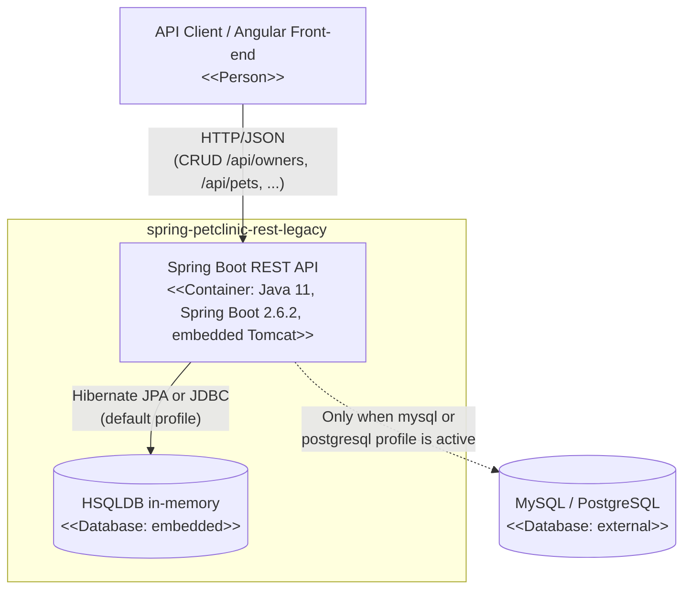
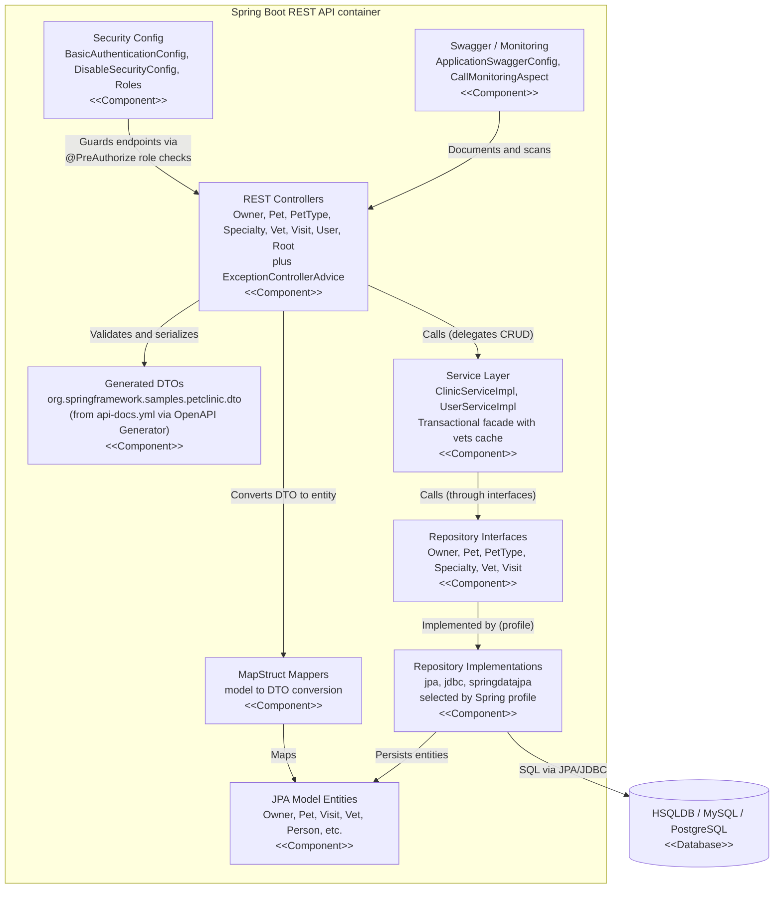

# Architecture: spring-petclinic-rest-legacy

## Project Overview
This repository is a **freeze-fork of `spring-petclinic/spring-petclinic-rest` at v2.6.2**, explicitly kept as a "javax-era legacy specimen" (per the repo description) for comparison/upgrade exercises. It is the REST-only, backend flavor of the classic Spring PetClinic sample: it exposes a JSON API for managing a veterinary clinic (owners, pets, pet types, visits, vets, specialties, users) with **no UI of its own** — the readme states that a separate Angular front-end consumes the API. It is written in Java on Spring Boot 2.6.2, using the legacy `javax.*` namespace (not `jakarta.*`) across its JPA, validation, and transaction code.

## Technology Stack
- **Language:** Java (JDK 11 per CI config; uses `javax.persistence`, `javax.validation`, `javax.transaction` — pre-Jakarta era)
- **Framework:** Spring Boot 2.6.2 (spring-boot-starter-parent), with starters for Web (embedded Tomcat), Data JPA, JDBC, Security, Actuator, AOP, Cache, Validation
- **Data access (3 interchangeable implementations, selected by Spring profile):**
  - Spring Data JPA (default active profile: `spring-data-jpa`)
  - Manual JPA repositories (`javax.persistence.EntityManager`)
  - Manual JDBC repositories (`JdbcTemplate`-style, in `repository/jdbc`)
- **Databases:** HSQLDB in-memory (default, `jdbc:hsqldb:mem:petclinic`), MySQL, PostgreSQL (drivers all included; profile files `application-hsqldb/mysql/postgresql.properties` exist)
- **API docs:** Springfox/Swagger 2 (`springfox-boot-starter` 3.0.0) with a Spring Boot 2.6 `ant_path_matcher` workaround; an `api-docs.yml` OpenAPI spec checked into resources
- **Codegen:** `openapi-generator-maven-plugin` generates the `dto` package (`*Dto` classes) from `api-docs.yml` at build time; `mapstruct` 1.4.1 maps entities ↔ DTOs at runtime
- **Build/deploy:** Maven (with wrapper), JaCoCo coverage gates, Jib (`jib-maven-plugin`) for container image builds (no Dockerfile in repo), GitHub Actions CI
- **Other:** Jackson (serialization), Spring Cache (`@Cacheable` on vets), Spring AOP call-monitoring aspect, i18n message bundles

## Component Architecture
All code lives under `src/main/java/org/springframework/samples/petclinic/`:

- **`PetClinicApplication`** — Spring Boot entry point; extends `SpringBootServletInitializer` so it can also be deployed as a WAR to an external servlet container, though it is run as a bootable JAR on port **9966** under context path **`/petclinic/`**.
- **`rest/` (REST controllers)** — `OwnerRestController`, `PetRestController`, `PetTypeRestController`, `SpecialtyRestController`, `VetRestController`, `VisitRestController`, `UserRestController`, plus `RootRestController` (health-style root endpoint). Each maps `/api/{resource}` CRUD endpoints, validates `@RequestBody @Valid` DTOs, converts validation failures into an `errors` response header via `BindingErrorsResponse`, and gates every endpoint with `@PreAuthorize("hasRole(@roles.OWNER_ADMIN)")`-style role checks. `ExceptionControllerAdvice` is a `@ControllerAdvice` that renders uncaught exceptions as JSON `ErrorInfo` payloads.
- **`mapper/`** — MapStruct interfaces (`OwnerMapper`, `PetMapper`, `PetTypeMapper`, `SpecialtyMapper`, `VetMapper`, `VisitMapper`, `UserMapper`) converting domain entities to generated `*Dto` objects and back.
- **`dto/`** (generated) — OpenAPI-generator-produced DTO classes (suffixed `Dto`) with bean-validation annotations; the wire contract for the API. Excluded from JaCoCo coverage since generated.
- **`model/`** — JPA entity hierarchy: `BaseEntity` → `NamedEntity` → `Person` → `Owner`/`Vet`/`User`, plus `Pet`, `PetType`, `Specialty`, `Visit`, `Role`.
- **`service/`** — `ClinicService`/`ClinicServiceImpl` (the main facade over the repositories; all methods are `@Transactional`, reads `readOnly = true`, and `findVets()` is `@Cacheable("vets")`; null-safe lookups that swallow `EmptyResultDataAccessException`/`ObjectRetrievalFailureException`) and `UserService`/`UserServiceImpl` for credentials.
- **`repository/`** — The most architecturally distinctive part: **repository interfaces with three parallel implementations** chosen by Spring `@Profile` — `jpa/` (manual JPA), `jdbc/` (manual JDBC, including row mappers and a `JdbcPet` shadow class), and `springdatajpa/` (Spring Data interfaces with a few `*Impl` finder methods and `*Override` adapters). `spring.profiles.active=hsqldb,spring-data-jpa` in `application.properties` selects Spring Data JPA + in-memory HSQLDB by default.
- **`security/`** — `BasicAuthenticationConfig` (HTTP Basic + JDBC-backed authentication from `users`/`roles` tables, enabled only when `petclinic.security.enable=true`) and `DisableSecurityConfig` (the default, since that property is `false`); `Roles` supplies the role constants referenced by `@PreAuthorize`.
- **`util/`** — `ApplicationSwaggerConfig` (Springfox `Docket`, `@EnableSwagger2`, and a `BeanPostProcessor` workaround for the Spring Boot 2.6/Springfox incompatibility), `CallMonitoringAspect` (AOP around-advice with JMX `@ManagedResource` metrics: call count, call time), and `EntityUtils`.
- **`resources/db/{hsqldb,mysql,postgresql}/`** — `initDB.sql` + `populateDB.sql` schema/seed scripts (HSQLDB ones auto-run at startup via `spring.sql.init`); plus `api-docs.yml` (OpenAPI spec driving DTO generation) and i18n `messages_*.properties`.

## Data Flow
A concrete write path, e.g. **`POST /petclinic/api/owners`**:

1. The request (JSON `OwnerDto`) hits the embedded Tomcat of the Spring Boot app. When security is enabled, the Spring Security filter chain first performs HTTP Basic authentication against the `users`/`roles` tables; `@PreAuthorize` then enforces the role check on the controller method (by default security is off, so this is skipped).
2. `OwnerRestController.addOwner` receives the body as a generated `OwnerDto`; Bean Validation runs via `BindingResult`. On validation failure the controller builds a `BindingErrorsResponse`, puts its JSON in an `errors` header, and returns 400.
3. On success, `OwnerMapper` (MapStruct) converts the DTO to the JPA `Owner` entity, and `ClinicServiceImpl.saveOwner` (a `@Transactional` facade) persists it through the active `OwnerRepository` implementation — by default `SpringDataOwnerRepository`, i.e. Hibernate against the in-memory HSQLDB.
4. The controller sets a `Location: /api/owners/{id}` header and returns the DTO with 201 Created.

Reads follow the same chain in reverse: controller → `ClinicService` (e.g. `findOwnerByLastName`) → repository interface → SQL against HSQLDB/MySQL/PostgreSQL → entities → mappers → DTOs → JSON. `RootRestController` serves a root landing resource, and Swagger UI/API docs are served from the same app (Springfox), while the checked-in `api-docs.yml` is the authoritative OpenAPI description used to regenerate the DTOs at build time.

## External Dependencies and Integrations
- **Database:** HSQLDB (default, in-memory), MySQL, or PostgreSQL — selected by Spring profile; schema and seed data come from the bundled SQL scripts. No other external messaging/queue/HTTP services are integrated.
- **Consumers:** an external Angular front-end (per readme) is the intended API consumer; no code for it is in this repo.
- **Build-time code generation:** OpenAPI Generator (from `api-docs.yml`) and MapStruct annotation processing — build-time dependencies only.
- **JVM services exposed:** Spring Boot Actuator endpoints and JMX (the call-monitoring aspect is a `@ManagedResource`).

## Deployment Architecture
- **Packaging:** Maven build (`mvnw` wrapper present) producing a Spring Boot executable JAR (plus WAR-capable via `SpringBootServletInitializer`); `spring-boot-maven-plugin` also emits `build-info` for Actuator.
- **Container image:** built with **Jib** (`jib-maven-plugin`) into `docker.io/springcommunity/spring-petclinic-rest` (tags `<version>` and `latest`). There is **no Dockerfile** in the repo.
- **Runtime config:** `server.port=9966`, context path `/petclinic/`; profile pair chosen via `spring.profiles.active` (default `hsqldb,spring-data-jpa`).
- **CI/CD:** a single GitHub Actions workflow (`.github/workflows/maven-build.yml`) runs `mvn -B install` on JDK 11 (AdoptOpenJDK, Maven cache) for pushes and PRs — notably targeting the `master` branch while the fork's default branch is `main`, so the workflow likely never triggers on this fork as-is. The build enforces JaCoCo coverage gates (87% line, 70% branch).
- **No k8s manifests or Helm charts** were found — deployment beyond the JAR/Jib image is out of scope for the repo.

## Security Considerations
- **Authentication is disabled by default** — `petclinic.security.enable=false` in `application.properties`; `DisableSecurityConfig` is active unless the property is flipped to `true`. Anyone reading the code should not assume the API is protected out of the box.
- **When enabled:** HTTP Basic authentication backed by JDBC against `users` (username/password/enabled) and `roles` (username/role) tables; CSRF is explicitly disabled; a `PasswordEncoder` bean is created via `PasswordEncoderFactories` (though the JDBC auth config does not explicitly wire it into password encoding).
- **Method-level authorization:** `@EnableGlobalMethodSecurity(prePostEnabled = true)` plus `@PreAuthorize("hasRole(@roles.OWNER_ADMIN)")` on every controller endpoint, with role constants centralized in `security/Roles`. Note the asymmetry: the controllers guard with role checks even though the default profile leaves auth off.
- **No secrets in code** — datasource credentials are in profile properties (HSQLDB default uses empty password for `sa`).
- Legacy note: `javax.*` security/JPA stack (Spring Boot 2.6.2) predates the Jakarta migration and the Spring Boot 2.x line is EOL — the point of keeping this fork as a "legacy specimen."

## C4 Diagrams

### System Context Diagram
The intended external actors (API clients, the Angular front-end, database admins) come from the readme and configuration; the repo documents its purpose clearly but contains no client code, so the diagram is kept to what the evidence supports:

```mermaid
flowchart TB
    Client["API Client / Angular Front-end
&lt;&lt;Person&gt;&gt;"]
    Developer["Developer / Operator
&lt;&lt;Person&gt;&gt;"]
    PetClinic["spring-petclinic-rest-legacy
&lt;&lt;System&gt;&gt;"]
    Database[("Relational Database
HSQLDB in-memory / MySQL / PostgreSQL
&lt;&lt;External System&gt;&gt;") ]
    Client -->|"Consumes REST API over HTTP/JSON
(port 9966, context path /petclinic/)"| PetClinic
    Developer -->|"Runs, configures profiles and
builds the container image"| PetClinic
    PetClinic -->|"Reads and writes clinic data (JDBC/JPA)"| Database
```

### Container Diagram
This is a single deployable unit: one Spring Boot web application (the in-memory HSQLDB case lives inside that process; MySQL/PostgreSQL are external when those profiles are used). No queues, workers, or sidecars exist in the repo:



### Component Diagram
Zooming into the Spring Boot REST API container — the layers found in `org.springframework.samples.petclinic`:

