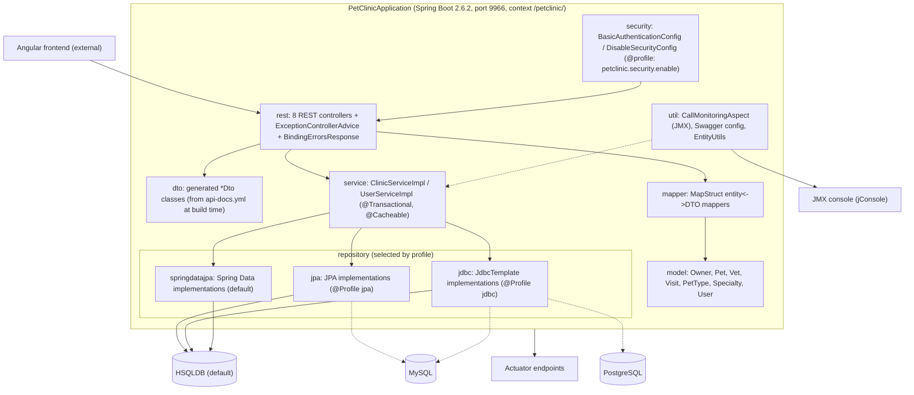
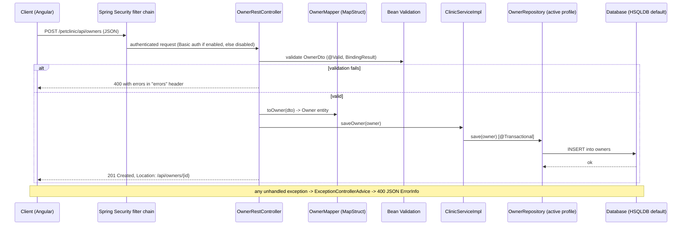
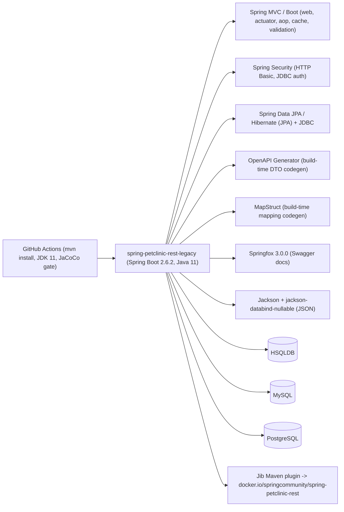

# Architecture: spring-petclinic-rest-legacy

## Project Overview
This repository is a freeze-fork of `spring-petclinic/spring-petclinic-rest` at v2.6.2, preserved as a "javax-era legacy specimen" (per the repo description, for a migration/exercise track). It is the REST-only backend of the classic Spring Petclinic sample application — "a backend version of the Spring Petclinic application [that] only provides a REST API. There is no UI." In pure Java on Spring Boot 2.6.2, it exposes CRUD JSON endpoints for owners, pets, pet types, vets, specialties, visits, and users, backed by a pluggable persistence layer.

## Technology Stack
- **Language/Platform:** Java 11 (CI uses AdoptOpenJDK 11), javax.* namespace (pre-Jakarta)
- **Framework:** Spring Boot 2.6.2 (web, data-jpa, jdbc, security, aop, cache, actuator, validation starters)
- **Persistence:** HSQLDB (default, in-memory), MySQL, and PostgreSQL drivers (runtime scope); three swappable repository implementations — plain JPA (Hibernate), raw JDBC, and Spring Data JPA — selected via Spring profiles
- **API generation:** OpenAPI Generator Maven plugin generates DTOs (`*Dto`) at build time from `src/main/resources/api-docs.yml`
- **Mapping:** MapStruct 1.4.1 (annotation-processed entity↔DTO mappers)
- **API docs:** Springfox 3.0.0 (Swagger), with the Spring Boot 2.6 `ant_path_matcher` workaround
- **Build/deploy:** Maven (wrapper included), JaCoCo coverage enforcement (87% line / 70% branch minimums), Jib Maven plugin (no Dockerfile), GitHub Actions CI

## Component Architecture
Grouped by package under `src/main/java/org/springframework/samples/petclinic/`:

- **`PetClinicApplication`** — Spring Boot entry point; extends `SpringBootServletInitializer`, so it can run as a jar or be deployed to a servlet container.
- **`rest/`** — REST controllers (`OwnerRestController`, `PetRestController`, `PetTypeRestController`, `VetRestController`, `VisitRestController`, `SpecialtyRestController`, `UserRestController`, `RootRestController`). Each maps under `/api/...`, validates inbound `*Dto` bodies with Bean Validation (`BindingResult`), maps DTO→entity via MapStruct, and delegates to `ClinicService`. `ExceptionControllerAdvice` is a `@ControllerAdvice` that converts any exception into a 400 with a JSON `ErrorInfo`; `BindingErrorsResponse` formats validation errors (returned in an `errors` response header, exposed via `@CrossOrigin`).
- **`service/`** — `ClinicServiceImpl` (annotated `@Service`, "a facade for all Petclinic controllers" holding `@Transactional` boundaries) and `UserServiceImpl`. The service layer translates repository `DataAccessException`s into "return null" semantics and caches vets with `@Cacheable("vets")`.
- **`model/`** — Domain entities (`Owner`, `Pet`, `PetType`, `Vet`, `Visit`, `Specialty`, `User`, `Role`) built on `BaseEntity`/`NamedEntity`/`Person`; JPA annotations with Bean Validation.
- **`repository/`** — The key architectural feature: each repository interface (e.g., `OwnerRepository`) has **three implementations selected by profile** — `jpa/` (JPA `EntityManager` with JPQL `join fetch` queries), `jdbc/` (JdbcTemplate with hand-written SQL and row mappers), and `springdatajpa/` (Spring Data interfaces plus `*Override` beans to keep profile wiring explicit). `application.properties` defaults to the `spring-data-jpa` profile.
- **`mapper/`** — MapStruct interfaces (`OwnerMapper`, `PetMapper`, etc.) converting domain entities to generated `org.springframework.samples.petclinic.dto.*Dto` types.
- **`security/`** — `BasicAuthenticationConfig` (HTTP Basic + JDBC authentication against `users`/`roles` tables, `@EnableGlobalMethodSecurity(prePostEnabled=true)` for `@PreAuthorize`) is only active when `petclinic.security.enable=true`; `DisableSecurityConfig` is the default. `Roles` exposes role constants (e.g., `OWNER_ADMIN`) referenced from `@PreAuthorize` expressions.
- **`util/`** — `CallMonitoringAspect` (JMX `@ManagedResource "petclinic:type=CallMonitor"` around-aspect that times `@Repository` bean calls), `ApplicationSwaggerConfig` (Swagger setup), `EntityUtils`.
- **`dto/` (generated)** — Not in source; produced during `mvn` build from `api-docs.yml` into `target/generated-sources/openapi`, added to the source path by `build-helper-maven-plugin`, and excluded from JaCoCo coverage.
- **`resources/`** — Profile properties for `hsqldb`/`mysql`/`postgresql` DBs and `jpa`/`jdbc`/`spring-data-jpa` repos, `initDB.sql`/`populateDB.sql` per database, `api-docs.yml` (the OpenAPI spec), and i18n bundles (`messages_en/de.properties`).

## Data Flow
Trace of `POST /petclinic/api/owners`: the request hits Spring's MVC layer, where the Spring Security filter chain (disabled by default; HTTP Basic against the `users` table when enabled) runs first. `OwnerRestController.addOwner` deserializes the body into the generated `OwnerDto`, runs Bean Validation; on failure it returns 400 with a `BindingErrorsResponse` in the `errors` header. Otherwise `OwnerMapper.toOwner` (MapStruct, compile-time generated) converts DTO → `Owner` entity, and `ClinicServiceImpl.saveOwner` runs inside a `@Transactional` method, calling `ownerRepository.save` — whichever of the JPA/JDBC/Spring-Data bean is active for the current profile (default: Spring Data JPA) persists to HSQLDB. The controller then sets the `Location` header to `/api/owners/{id}` and returns 201 with the populated DTO. Read flows are analogous, with `findOwnerById` returning `null` (→ 404) when the repository throws `EmptyResultDataAccessException`. All exceptions escaping a controller are caught by `ExceptionControllerAdvice` and rendered as a 400 JSON error. Repository calls are additionally timed by `CallMonitoringAspect` for JMX monitoring.

## External Dependencies and Integrations
- **Database:** HSQLDB (embedded, default), MySQL, or PostgreSQL — the only stateful dependency; schema + seed data ship as SQL scripts per DB.
- **Client frontend:** an Angular application (separate, not in this repo) consumes the REST API per the readme.
- **JMX:** `CallMonitoringAspect` exposes an MBean consumable by jConsole or any JMX client.
- **Actuator:** Spring Boot Actuator endpoints exposed for health/info.
- No message queues, caches beyond in-process `@Cacheable`, or third-party SaaS integrations were found.

## Deployment Architecture
- **Packaging:** Spring Boot Maven plugin produces an executable jar with build-info (surfaced by Actuator).
- **Container image:** built **without a Dockerfile** via the Jib Maven plugin, targeting `docker.io/springcommunity/spring-petclinic-rest` with `<version>` and `latest` tags.
- **CI/CD:** a single GitHub Actions workflow (`.github/workflows/maven-build.yml`) runs `mvn -B install` on JDK 11 (Maven caching) — which also runs the full test suite and the JaCoCo coverage gate (87% line / 70% branch). Notably, the workflow triggers on `master`, but this fork's default branch is `main`, so the workflow as-is would not fire on this repo.
- **No Kubernetes manifests or Helm charts** exist in the repository.
- Configuration at deploy time is purely Spring profiles (`hsqldb|mysql|postgresql` × `jpa|jdbc|spring-data-jpa`), `server.port` (default 9966), and `petclinic.security.enable`.

## Security Considerations
- **Authentication is off by default:** `petclinic.security.enable=false` in `application.properties` activates `DisableSecurityConfig`, meaning all endpoints are unauthenticated out of the box.
- **When enabled:** HTTP Basic auth with users validated against the `users` table (`select username,password,enabled from users`) and roles from the `roles` table via `JdbcAuthentication`; CSRF is explicitly disabled (appropriate for a stateless API).
- **Method-level authorization:** `@PreAuthorize("hasRole(@roles.OWNER_ADMIN)")`-style annotations guard controller methods; role names come from the injectable `Roles` bean.
- **Passwords:** `PasswordEncoderFactories` is imported in `BasicAuthenticationConfig` (a `PasswordEncoder` bean is provided), but plaintext storage in the seed SQL data cannot be verified from what was inspected.
- **Error handling leaks details:** `ExceptionControllerAdvice` returns the exception class name and message in every 5xx-shaped 400 response, which can expose stack/implementation detail.
- **Validation:** Bean Validation on DTOs plus a global exception handler form the input-safety boundary.

## Diagrams

### Component Diagram

### Data Flow Diagram

### Dependency Diagram
